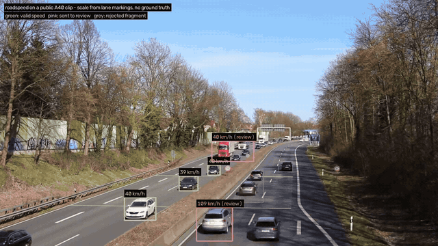
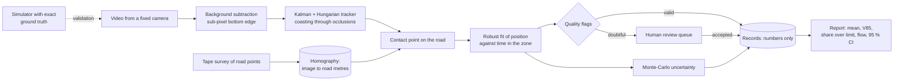
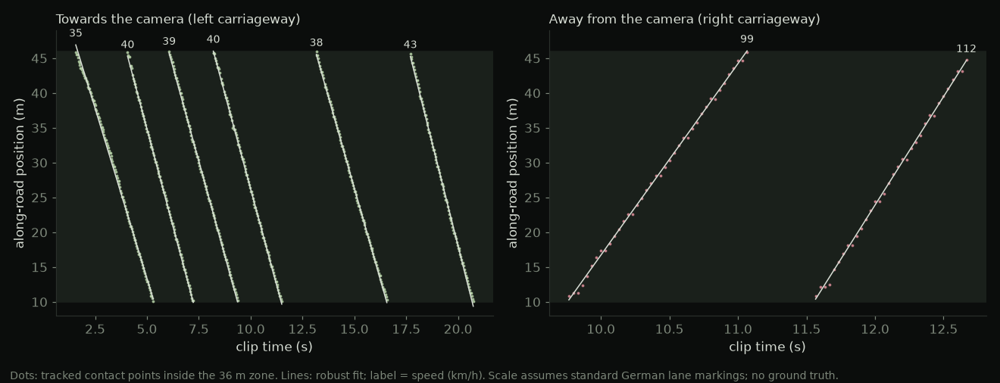
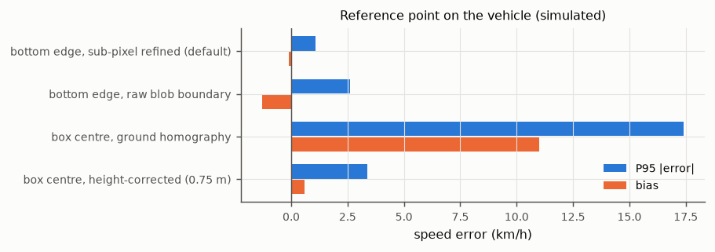

# Road-speed audit from one fixed camera

I built an offline, open-source tool that measures vehicle speeds on one road segment from one fixed camera, puts an uncertainty on every number, and sends doubtful records to a person instead of into the statistics. Then I built a road-scene simulator to find out how far its numbers can be trusted.

[](https://github.com/Kronbii/road-speed-audit/actions/workflows/ci.yml)




*The tool's first run on real footage, a public clip of Germany's A40. The scale comes from standard lane-marking lengths, not a survey, and there is no reference measurement, so **these speeds are unvalidated**. It gave 8 valid speeds, sent 3 to review and rejected 31 fragments.*
*Based on "Motorway A40 - on bridge above the traffic" by Kathinka Engels, [CC BY 3.0](https://creativecommons.org/licenses/by/3.0), via [Wikimedia Commons](https://commons.wikimedia.org/wiki/File:Motorway_A40_-_on_bridge_above_the_traffic.webm); annotations added.*

> **Status.** Every accuracy figure in this README comes from **simulated** video with exact ground truth. The tool has **not** been checked against radar or GPS on a real road yet; a [field protocol](docs/field-protocol.md) for that is written. It is an audit tool for planning, **not** a certified enforcement device ([ethics statement](docs/ethics.md)).

## Results (simulated video)

On the baseline set-up (a camera on a 6 m pole watching a zone 20 to 50 m away at 30 frames per second; 10 runs × 120 s, `results/e01_baseline.json`), 118 of 134 simulated vehicles received a valid speed, none was missed, and no valid record was false or duplicated.

| | Result | Context |
|---|---|---|
| Speed error, 95th percentile | **1.01 km/h** | 118 valid vehicles; bias −0.23 km/h, RMSE 0.52 km/h, maximum 2.58 km/h |
| 85th-percentile speed (V85) | **1.22 km/h RMSE** | the number a municipality plans with, over 20 simulated traffic runs (`results/e10_v85.json`) |
| Recommended zone | **≤ 25 m** from the pole | for a 95th-percentile error under 2 km/h with at least 80 % of vehicles measured |
| Tracked point | **1.1 vs 17.4 km/h** | sub-pixel bottom edge against the uncorrected box centre (95th-percentile error) |
| Simulated runs | **221** | over 13 experiments: distance, height, tilt, resolution, frame rate, density, calibration, lighting, tracked point |

## 1. Why speed, and what this is

Speed is one of the main risk factors on roads: the World Health Organization estimates that every 1 % increase in mean speed raises the risk of a fatal crash by about 4 %. A municipality that wants to calm a street, argue for a crossing or check whether a measure worked needs speed data for *that* street. Radar surveys cost money and staff time. A camera on a lamp post is cheap, but its numbers are only useful if their error is known, and only acceptable if it does not become a surveillance device.

So `roadspeed` is built around auditability. It writes numbers, not images. Every speed leaves with an uncertainty. Doubtful records (merged vehicles, gaps, large residuals) go to a human review queue. The report gives the statistics a municipality uses: mean speed, V85, share over the limit and flow, by lane and direction, with 95 % confidence intervals. And the method's accuracy, including where it fails, is measured before anyone relies on it.

The hard part of validating speed measurement is ground truth: on a real road, the true speed of every car is exactly what nobody has. That is why the repository includes a renderer that draws road scenes through a calibrated camera and knows every vehicle's true speed. The full pipeline runs on those frames exactly as it would on a video file.

## 2. How it works



1. **Calibrate.** Six or more surveyed road points clicked on one frame give an image-to-road homography, with residuals and a recovered camera (focal length, height, tilt) as a plausibility check. See the [calibration guide](docs/calibration.md).
2. **Track.** OpenCV background subtraction that keeps shadow pixels attached to real vehicles, a bottom edge located to a fraction of a pixel, a two-stage Kalman and Hungarian tracker in the style of ByteTrack that coasts through occlusions, and stitching of partial tracks in road coordinates.
3. **Measure.** The point where the tyres meet the road is mapped onto the road plane, and a robust straight-line fit of position against time inside the measurement zone gives the speed. Hard flags reject a record; soft flags send it to review.
4. **Carry the uncertainty.** Monte Carlo over the calibration clicks, the survey and the pixel positions gives each speed its uncertainty. Calibration error is shared by every vehicle of a run, so the report carries it into the intervals of mean speed and V85 instead of letting it average away.
5. **Report.** `records.csv` and `records.json` (no images), a review queue with optional anonymised review sheets, and an HTML report. An example from a simulated clip is in [`results/demo/`](results/demo/).

On the A40 clip, each valid vehicle is a straight line of position against time, and its slope is its speed:



*Same unvalidated A40 run as above (scale from lane markings, no reference measurement).*

## 3. Validation on simulated video


*A frame from the simulator, which knows every vehicle's true speed. White boxes: tracked vehicles with measured and true speed; green: the 30 m measurement zone. Simulated, not a real road.*

`roadspeed synth` renders road scenes with a calibrated pinhole camera: textured road, lane markings, pavements and buildings, cars, SUVs, vans, trucks, buses and motorcycles as shaded 3-D boxes with wheels, cast shadows, motion blur, lighting drift, sensor noise, JPEG compression and static occluders, at any frame rate or resolution. The calibration is simulated too: nine lane-marking points clicked with 0.7 px error and "surveyed" with 2 cm error.

The **baseline set-up** is a two-lane, two-way road, a camera on a 6 m pole 1.5 m outside the shoulder, a 60° field of view at 1280×720 and 30 frames/s, aimed at a 30 m zone 20–50 m from the pole, with 300 vehicles/h per lane. Each experiment varies one thing. Every table below is copied verbatim from `results/tables.md`, which `experiments/tables.py` generates from `results/*.json`; a test checks that they match. 95 % CIs are bootstrap intervals over vehicles; "valid %" is the share of simulated vehicles that got an unflagged speed; "95 % CI coverage" is the share whose stated interval contains the true speed.

### What I found

- **Distance matters most.** Each pixel covers more road further away, so at 75 m the 95th-percentile error reaches 7.6 km/h and fewer than half the vehicles are measured.
- **The tracked point matters almost as much.** The box centre, without a height correction, gave 17.4 km/h; the bottom edge located to a fraction of a pixel gave about 1 km/h.
- **Calibration layout beats tape precision.** Four points bunched at one end of the zone gave about five times the bias of nine points spread over it.
- **One lamp post in the line of sight** cut the share of vehicles measured from 86 % to 50 %.
- **Noise, compression and motion blur barely mattered.** Dusk and scenes without cast shadows did: the error doubled to about 1.8 km/h and the stated uncertainty became too small, which is the more dangerous failure.
- **A few reference passes help.** In one low-resolution, far-zone run, five passes of a car at a known speed cut the bias from about 6 % to under 2 % (an illustration, not a measurement).


### Baseline accuracy (E01)

| metric | value |
|---|---:|
| simulated runs x duration | 10 x 120 s |
| vehicles crossing the zone | 134 |
| valid speed / review only / rejected only / missed | 118 / 6 / 10 / 0 |
| bias (km/h) [95% CI] | -0.23 [-0.33, -0.15] |
| RMSE (km/h) [95% CI] | 0.52 [0.36, 0.67] |
| P95 abs error (km/h) [95% CI] | 1.01 [0.67, 1.85] |
| max abs error (km/h) | 2.58 |
| relative error: bias / P95 abs (%) | -0.33 / 1.63 |
| per-vehicle 95% interval covers the truth | 92 % |
| median stated uncertainty u (km/h) | 0.41 |
| false valid records / duplicate valid records | 0 / 0 |
| ID switches / fragmentations inside the zone | 11 / 31 |

Approaching vehicles were measured less accurately than receding ones, and motorcycles had the largest errors. Relative to speed, the 95th-percentile error stayed between 0.9 and 1.6 % in every speed band (`results/e07_speed.json`).

<details>
<summary><b>Camera placement: distance, height, tilt, frame rate (E02–E04, E06)</b></summary>

**Distance of the zone centre from the pole** (30 m zone, camera re-aimed at its centre):

| zone centre (m) | runs | vehicles | valid % | bias km/h | RMSE km/h | P95 abs km/h [95% CI] | 95% CI coverage |
|---:|---:|---:|---:|---:|---:|---:|---:|
| 25 | 4 | 46 | 87 | -0.21 | 0.35 | 0.76 [0.52, 0.92] | 90 |
| 40 | 4 | 46 | 78 | -0.57 | 0.75 | 1.58 [1.03, 1.72] | 86 |
| 55 | 4 | 45 | 78 | -1.51 | 1.96 | 3.59 [3.05, 4.19] | 54 |
| 75 | 4 | 46 | 43 | -3.93 | 4.54 | 7.60 [5.78, 8.69] | 15 |
| 95 | 4 | 47 | 21 | -5.74 | 6.56 | 10.84 [6.47, 13.46] | 20 |
| 115 | 4 | 45 | 0 | – | – | – | – |

**Camera height:**

| height (m) | runs | vehicles | valid % | bias km/h | RMSE km/h | P95 abs km/h [95% CI] | 95% CI coverage |
|---:|---:|---:|---:|---:|---:|---:|---:|
| 3.0 | 4 | 39 | 87 | -0.35 | 0.89 | 1.75 [1.28, 2.11] | 82 |
| 4.5 | 4 | 39 | 95 | -0.11 | 0.49 | 0.85 [0.66, 1.68] | 86 |
| 6.0 | 4 | 39 | 100 | 0.04 | 0.29 | 0.62 [0.37, 0.91] | 97 |
| 8.0 | 4 | 39 | 100 | -0.06 | 0.25 | 0.48 [0.29, 0.95] | 97 |
| 10.0 | 4 | 39 | 100 | -0.06 | 0.15 | 0.26 [0.17, 0.51] | 100 |
| 12.0 | 4 | 39 | 100 | -0.13 | 0.19 | 0.37 [0.21, 0.58] | 100 |


Tilt (±6° around aiming at the zone centre) changed little: 1.03–1.38 km/h at 91 % valid. Frame rates from 10 to 50 frames/s made no measurable difference for a 30 m zone (`results/e04_tilt.json`, `results/e06_fps.json`).

</details>

<details>
<summary><b>Field of view and resolution act through metres per pixel (E05)</b></summary>

Zone 40–70 m, 3 runs × 90 s per condition.

| condition | cm of road per px | valid % | bias km/h | RMSE km/h | P95 abs km/h [95% CI] |
|---|---:|---:|---:|---:|---:|
| HFOV 30 deg, 1280 px | 21.5 | 97 | -0.05 | 0.39 | 0.95 [0.39, 1.00] |
| HFOV 45 deg, 1280 px | 33.2 | 97 | -0.48 | 0.69 | 1.30 [0.97, 1.70] |
| HFOV 60 deg, 1280 px | 46.3 | 87 | -0.96 | 1.34 | 2.18 [1.58, 3.90] |
| HFOV 75 deg, 1280 px | 61.5 | 65 | -2.05 | 2.68 | 4.02 [3.34, 7.26] |
| HFOV 60 deg, 640 px | 92.6 | 55 | -3.70 | 4.48 | 7.76 [5.20, 9.86] |
| HFOV 60 deg, 960 px | 61.7 | 84 | -1.79 | 2.37 | 3.87 [2.85, 6.39] |
| HFOV 60 deg, 1920 px | 30.9 | 87 | -0.65 | 0.91 | 1.94 [1.13, 2.33] |


</details>

<details>
<summary><b>Calibration error (E09)</b></summary>

Detection and tracking run once per seed (6 runs × 90 s); speed estimation repeated with 8 simulated field calibrations per setting. Calibration error is shared by every vehicle of a run, so it shows up as a per-run bias.

| varied | value | simulated calibrations | mean abs run bias % | P95 abs run bias % | per-vehicle CI coverage |
|---|---|---:|---:|---:|---:|
| click | 0.25 | 48 | 0.23 | 0.54 | 80 % |
| click | 0.5 | 48 | 0.28 | 0.67 | 88 % |
| click | 1.0 | 48 | 0.56 | 1.33 | 92 % |
| click | 2.0 | 48 | 1.15 | 2.69 | 92 % |
| click | 3.0 | 48 | 1.64 | 3.86 | 95 % |
| click | 5.0 | 48 | 2.83 | 6.47 | 96 % |
| survey | 0.0 | 48 | 0.49 | 1.27 | 92 % |
| survey | 0.02 | 48 | 0.49 | 1.18 | 97 % |
| survey | 0.05 | 48 | 0.52 | 1.11 | 100 % |
| survey | 0.1 | 48 | 0.66 | 1.53 | 100 % |
| layout | compact | 48 | 3.32 | 7.08 | 97 % |
| layout | near_half | 48 | 1.30 | 3.10 | 98 % |
| layout | zone | 48 | 0.50 | 1.32 | 94 % |


</details>

<details>
<summary><b>Traffic density, occlusion and the tracker (E08)</b></summary>

3 runs × 90 s per condition.

| road | flow /lane/h | variant | vehicles | valid % | zone ID sw. + frag. /100 veh | P95 abs km/h | MOTA |
|---|---:|---|---:|---:|---:|---:|---:|
| 2-lane | 150 | default | 22 | 91 | 18.2 | 0.89 | 0.89 |
| 2-lane | 300 | default | 36 | 86 | 30.6 | 0.60 | 0.84 |
| 2-lane | 500 | default | 40 | 98 | 12.5 | 0.82 | 0.79 |
| 2-lane | 700 | default | 39 | 90 | 12.8 | 0.86 | 0.83 |
| 4-lane | 300 | default | 66 | 92 | 21.2 | 0.95 | 0.81 |
| 4-lane | 450 | default | 77 | 88 | 26.0 | 0.92 | 0.79 |
| 4-lane | 600 | default | 81 | 83 | 29.6 | 0.96 | 0.74 |
| 2-lane | 300 | lamp post | 36 | 50 | 94.4 | 1.52 | 0.74 |
| 2-lane | 300 | lamp post, no occlusion handling | 36 | 53 | 105.6 | 2.00 | 0.70 |
| 4-lane | 450 | no occlusion handling | 77 | 86 | 35.1 | 0.96 | 0.74 |


Accuracy held up with traffic; a single lamp post crossing the line of sight did far more damage than density. Turning off the tracker's occlusion handling made things somewhat worse, but it does not solve the static-occluder case.

</details>

<details>
<summary><b>Imaging conditions (E11)</b></summary>

3 runs × 90 s per condition (34 vehicles each).

| condition | vehicles | valid % | bias km/h | P95 abs km/h | 95% CI coverage |
|---|---:|---:|---:|---:|---:|
| baseline (shadows, noise 2, JPEG 90) | 34 | 100 | -0.26 | 0.91 | 97 % |
| no cast shadows | 34 | 100 | -0.78 | 1.82 | 59 % |
| low sun (elevation 20 deg, long shadows) | 34 | 82 | -0.18 | 0.82 | 100 % |
| sensor noise sigma 4 | 34 | 100 | -0.20 | 0.88 | 100 % |
| sensor noise sigma 8 | 34 | 100 | -0.05 | 0.84 | 100 % |
| JPEG quality 60 | 34 | 100 | -0.24 | 0.87 | 97 % |
| JPEG quality 30 | 34 | 97 | -0.23 | 0.93 | 100 % |
| motion blur, 1/250 s exposure | 34 | 100 | -0.25 | 0.89 | 97 % |
| motion blur, 1/100 s exposure | 34 | 100 | -0.25 | 0.87 | 97 % |
| motion blur, 1/30 s exposure | 34 | 100 | -0.04 | 1.19 | 100 % |
| lighting drift +-15 % (20 s period) | 34 | 100 | -0.03 | 1.09 | 97 % |
| exposure jumps (x0.7 at 30 s, x1.4 at 60 s) | 34 | 91 | -0.04 | 1.38 | 90 % |
| dusk: 45 % light, noise 4 | 34 | 100 | -0.82 | 1.82 | 59 % |


</details>

<details>
<summary><b>Which point stands for the vehicle (E12), and reference passes (E13)</b></summary>

| model | vehicles | valid % | bias km/h | RMSE km/h | P95 abs km/h |
|---|---:|---:|---:|---:|---:|
| bottom edge, sub-pixel refined (default) | 34 | 100 | -0.10 | 0.50 | 1.07 |
| bottom edge, raw blob boundary | 34 | 100 | -1.30 | 1.46 | 2.60 |
| box centre, ground homography | 34 | 79 | 11.00 | 11.78 | 17.42 |
| box centre, height-corrected (0.75 m) | 34 | 88 | 0.59 | 1.50 | 3.36 |



Mean absolute run bias in % of speed, after correcting with k passes of a vehicle at a known speed:

| case | runs | none | k=1 | k=3 | k=5 | k=10 | k=20 |
|---|---:|---:|---:|---:|---:|---:|---:|
| 360p_zone40-70 | 1 | 6.10 | 2.50 | 1.87 | 1.71 | – | – |
| 720p_baseline | 10 | 0.39 | 0.31 | 0.22 | 0.20 | 0.24 | – |

</details>

<details>
<summary><b>Municipal statistics on simulated traffic (E10)</b></summary>

20 runs × 180 s, speeds drawn from Normal(62, 12) km/h (an assumed distribution), limit 50 km/h.

| statistic | runs | mean error | RMSE | max abs error | 95% CI covers truth | mean CI width |
|---|---:|---:|---:|---:|---:|---:|
| mean speed (km/h) | 20 | -0.07 | 0.60 | 1.26 | 100 % | 9.35 |
| V85 (km/h) | 20 | -0.03 | 1.22 | 4.22 | 100 % | 13.55 |
| share over 50 km/h | 20 | -0.65 | 1.59 | 3.85 | 100 % | 24.83 |

Share over the limit in percentage points. All 20 intervals contained the true value, but they are wide because each run has only 19–29 vehicles; a real survey over days would have far more.


</details>

**Is the stated uncertainty honest?** Where random error dominates, the per-vehicle 95 % intervals covered the truth for 82–100 % of valid records. Where a systematic error dominates, they are too narrow: 54 % coverage with the zone centred 55 m away, 59 % without cast shadows, 6 % with the raw blob boundary. The uncertainty model carries calibration and pixel noise only; the field validation has to measure the systematic part.

## 4. Placement guidance (from simulation only)

`experiments/guidance.py` turns the sweeps into statements (`results/guidance.json`). A level meets a target when the 95th percentile of |error| is at most the target **and** at least 80 % of simulated vehicles got a valid speed, one parameter varied at a time around the baseline.

| parameter | target: 95 % of valid speeds within ±2 km/h | target: within ±1 km/h | source |
|---|---|---|---|
| camera height | all tested heights (3–12 m) met it | 4.5 m or higher | `e03_height.json` |
| distance of zone centre from the pole | 25 m met it; at 40 m the error met it but only 78 % of vehicles were measured | 25 m | `e02_distance.json` |
| road length per pixel along the road, at the zone centre | at most 33 cm | at most 21 cm (one tested condition) | `e05_resolution.json` |
| frame rate | 10 frames/s and above (all tested, 10–50) | 10 frames/s and above | `e06_fps.json` |
| tilt (±6° around aiming at the zone centre) | every level met it | no level met it (1.03–1.38 km/h) | `e04_tilt.json` |
| traffic flow per lane | up to 700 veh/h (2-lane) and 600 veh/h (4-lane), the highest tested | same | `e08_density.json` |

In words, for a two-lane road in this simulator: **mount the camera at least 4.5 m high, keep the zone centre within about 25–40 m of the pole so that one pixel covers no more than about a third of a metre of road, keep poles and trees out of the line of sight, and spread the calibration points over the whole zone.** The field pilot has to confirm all of it.

## 5. Quick start

Requires Python 3.11 or newer, numpy, scipy, opencv-python and matplotlib. No GPU, no downloads, no network at run time.

```bash
git clone https://github.com/Kronbii/road-speed-audit
cd road-speed-audit
make setup        # .venv with the package and dev tools
make test         # unit tests and a simulated end-to-end test
make demo         # render a 60 s simulated clip, measure it, write work/demo/run/report.html
```

On your own video:

```bash
source .venv/bin/activate

# 1. calibrate once per site (see docs/calibration.md)
roadspeed calibrate --video my_road.mp4 --frame 200 --survey survey.json \
  --out site.json --zone 20 50 \
  --lane towards-1:-1.75:3.5:towards --lane away-1:1.75:3.5:away \
  --speed-limit 50 --check-image check.png

# 2. measure
roadspeed run my_road.mp4 --config site.json --out run/ --review-sheets

# 3. review flagged records, then report
roadspeed review run/
roadspeed report run/ --title "Main Street, week 1"
```

To regenerate every result: `make reproduce-quick` (minutes, writes `results/quick/`) or `make reproduce` (roughly 1.5–2 h with 6 worker processes; `ROADSPEED_WORKERS` sets the number). Seeds are fixed, so `make reproduce` rewrites `results/` and `figures/` byte for byte on the same software stack.

## 6. Repository layout

```
src/roadspeed/        calibration, detection, tracking, stitching, speed, uncertainty,
                      review, privacy, report, CLI
src/roadspeed/synth/  the road-scene simulator
experiments/          the 13 experiments, run_all.py, placement guidance, tables
results/              experiment outputs (JSON / CSV), tables.md, a demo report
figures/              experiment figures
docs/                 calibration guide, field protocol, ethics statement, summary
tests/                pytest suite
```

## 7. Limits and what's next

- **Every figure comes from simulated video:** a flat, straight road, an ideal lens and box-shaped vehicles. The tool has not been checked against radar or GPS on a real road. Its first run on real footage, the A40 clip above, has no reference speeds to compare against.
- **The method was tuned on the same simulator**, on other seeds, so real video will likely do worse than these numbers.
- **Accuracy falls quickly with distance**, and static occluders such as lamp posts cut the share of vehicles measured.
- **Dusk and scenes without cast shadows** raise the error to about 1.8 km/h and make the stated uncertainty too small.
- **Statistics exclude flagged records** until a person accepts them, and the optional YOLO backend is unit-tested with a stand-in model only.
- **It is an audit tool for planning, not a certified enforcement device**, and it should not become one ([ethics statement](docs/ethics.md)).

Next is a field check on one real road, following the [field protocol](docs/field-protocol.md): calibrate with a tape, validate against a GNSS probe vehicle and, if available, a radar gun, decide against acceptance criteria fixed in advance, and only then run a measurement week and publish the aggregated statistics with their intervals.

## 8. Read more

- Project page: [ramikronbi.com/projects/road-speed-audit](https://ramikronbi.com/projects/road-speed-audit)
- Write-up: [Measuring road speed with one camera, and knowing how wrong it is](https://ramikronbi.com/writing/measuring-road-speed-with-one-camera)
- World Health Organization, [Road traffic injuries fact sheet](https://www.who.int/news-room/fact-sheets/detail/road-traffic-injuries)
- Methods this builds on: Hartley and Zisserman, *Multiple View Geometry in Computer Vision* (homography); Zivkovic, ICPR 2004 (MOG2 background subtraction); Bewley et al., ICIP 2016 (SORT); Zhang et al., ECCV 2022 (ByteTrack); Bland and Altman, *The Lancet* 1986 (agreement analysis for the field check).
- A40 clip: "Motorway A40 - on bridge above the traffic" by Kathinka Engels, [CC BY 3.0](https://creativecommons.org/licenses/by/3.0), via [Wikimedia Commons](https://commons.wikimedia.org/wiki/File:Motorway_A40_-_on_bridge_above_the_traffic.webm).

MIT licence ([LICENSE](LICENSE)); citation metadata in [CITATION.cff](CITATION.cff).

Built by Rami Kronbi — [ramikronbi.com](https://ramikronbi.com)
