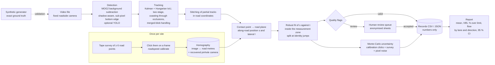

# road-speed-audit

**Measuring vehicle speeds on one road segment with one fixed camera — and showing,
on simulated video with exact ground truth, how accurate that is and what makes it
fail.**

`roadspeed` is an offline, open-source tool: a calibrated homography maps the
camera image to metres on the road, a background-subtraction detector and a
SORT/ByteTrack-style tracker follow vehicles, and a robust fit of position against
time over a defined measurement zone gives each vehicle a speed, an uncertainty and
quality flags. It writes numbers, not images, sends doubtful records to a human
review queue, and produces the statistics a municipality uses: mean speed, 85th
percentile speed (V85, the speed at or below which 85 % of vehicles travel, a
statistic widely used in speed-limit setting practice; FHWA, 2012), share over the limit and flow,
by lane and direction, with confidence intervals.

It is step one of a road-safety pilot by Space², an emerging Lebanese innovation
space that turns local needs into public-interest products: *a camera, a
homography and a tracker that measure vehicle speed on one road segment, verified
against ground truth. No faces, offline first, human review. One municipality, one
road.*

> **Status.** All accuracy figures below come from **simulated** video produced by
> the generator in this repository. The tool has **not** been validated against a
> radar or GPS reference on a real road yet; [docs/field-protocol.md](docs/field-protocol.md)
> describes how that will be done. It is an audit tool for planning, **not** a
> certified enforcement device ([docs/ethics.md](docs/ethics.md)).

RESULTS-HERO

---

## 1. Why speed

- Road traffic crashes kill approximately 1.16 million people a year and are the
  leading cause of death for children and young adults aged 5–29 (WHO, 2026).
- Speed is a central risk factor: "every 1 % increase in mean speed produces a 4 %
  increase in the fatal crash risk and a 3 % increase in the serious crash risk",
  and the risk of death for pedestrians hit by car fronts rises 4.5 times from
  50 km/h to 65 km/h (WHO, 2026).
- In Lebanon, WHO's 2023 country profile lists 378 reported road deaths for 2021
  against a WHO estimate of 544 (95 % CI 471–617), i.e. 9.7 per 100 000
  population; 39 % of reported fatalities were pedestrians. The national maximum
  urban speed limit is 50 km/h, and local authorities can modify limits
  (WHO, 2023).

A municipality that wants to calm a street, argue for a crossing or check whether
a measure worked needs speed data for *that* street. Radar surveys and permanent
detectors cost money and staff time; a camera on a lamp post is cheap, but only
useful if its numbers can be trusted and if it does not become a surveillance
device. This project tries to make the measurement auditable: every number comes
with an uncertainty, every doubtful case is flagged for a person, and the method's
accuracy is characterised before anyone relies on it.

## 2. How it works



**Calibration.** At least four (in practice 8–10) surveyed road points clicked in
an OpenCV picker with a magnifier, or loaded from JSON, give an image→ground
homography (normalised DLT, refined on image-space residuals). The tool reports
reprojection residuals, checks that the zone is inside the image, and recovers a
pinhole camera (focal length, height, tilt) from the homography as a plausibility
check. A helper builds points from dashed lane markings of measured geometry (it
documents a shear ambiguity that leaves along-lane speeds unaffected). See
[docs/calibration.md](docs/calibration.md).

**Detection.** OpenCV MOG2 background subtraction, initialised from the median of
frames spread over the clip, restricted to a region of interest derived from the
calibration. Grey vehicles on grey asphalt are often labelled "shadow" by MOG2, so
shadow pixels connected to real foreground are kept. The foreground threshold sits
in the tail of a blurred edge, which places the blob's bottom a few pixels below
the vehicle; the bottom edge is therefore re-located at sub-pixel precision at the
50 % level of the difference to the background model (experiment E12 measures what
this buys). An optional YOLO backend (`pip install roadspeed[yolo]`, local weights
only) is included but not exercised by the experiments.

**Tracking.** A constant-velocity Kalman filter on boxes, Hungarian assignment on
1 − IoU in ByteTrack's two stages, a centre-distance fallback for small fast boxes,
coasting for up to 1 s through occlusions, and merged-blob handling: when one blob
covers two predicted vehicles (typical when opposite-direction traffic crosses far
from a roadside camera) only the vehicle whose bottom edge the blob matches is
updated, the other coasts (for up to 3 s). After tracking, partial tracks of one
vehicle (typically restarted after such a merge) are stitched in road coordinates
when lane, direction, speed and the predicted position at the junction agree.

**Speed.** The bottom-centre of each box is mapped to the road plane and expressed
as along-road position *s*. A Huber-robust straight line *s(t)* over the
observations inside the measurement zone gives the speed. Tracks are split where
*s* jumps or reverses (an identity carried from one vehicle to another). Hard flags
(too few points, partial zone, implausible speed) reject a record; soft flags (large
residuals, gaps, merged or wide blobs, ambiguous lane, direction mismatch, high
uncertainty) send it to review.

**Uncertainty.** Monte Carlo over the calibration (click noise and tape noise on
every control point, re-fit, re-project, re-fit the speed) and over the contact
point (pixel noise estimated per track from the fit residuals). Calibration error
is shared by all vehicles of a run, so the report carries its draws into the
confidence intervals of mean speed and V85 instead of letting it average away.

**Outputs.** `records.csv` / `records.json` (time, lane, direction, speed,
uncertainty, interval, quality flags; no images), `summary.json`,
`review_queue.json`, optional anonymised review sheets (pixelated, blurred crops
plus the position-time fit), and `report.html` with figures.

## 3. Validation on simulated video

### The generator

`roadspeed synth` renders road scenes with a calibrated pinhole camera in
numpy/OpenCV: a procedurally textured road plane with analytically anti-aliased
lane markings, pavements and roadside buildings, vehicles as shaded multi-part
3-D boxes with realistic sizes, ground clearance and wheels (cars, SUVs, vans,
trucks, buses, motorcycles), two or four lanes in both directions, speeds drawn
from 20–120 km/h, Poisson arrivals with no in-lane overtaking, cast and contact
shadows, optional motion blur, lighting drift and exposure jumps, sensor noise
and JPEG compression, static occluders, and any frame rate or resolution. Every
vehicle's true speed and every frame's true visible box (from an ID buffer) are
known exactly. Frames are deterministic per seed.

The experiments run the *full* pipeline on the rendered frames, exactly as on a
video file, and match records to simulated vehicles frame by frame. The
calibration is simulated too: nine lane-marking points at the start, middle and
end of the zone, clicked with 0.7 px Gaussian error and rounded to whole pixels,
"surveyed" with 2 cm error.

**Baseline set-up:** two-lane two-way road (3.5 m lanes), camera on a 6 m pole
1.5 m outside the shoulder, 60° horizontal field of view, 1280×720, 30 frames/s,
aimed at the centre of a 30 m measurement zone 20–50 m from the pole,
300 vehicles/h per lane.

RESULTS-BODY

## 5. Run it on your own video

```bash
make setup                                   # .venv with the package and dev tools
source .venv/bin/activate

# 1. calibrate once per site (see docs/calibration.md)
roadspeed calibrate --video my_road.mp4 --frame 200 --survey survey.json \
  --out site.json --zone 20 50 \
  --lane towards-1:-1.75:3.5:towards --lane away-1:1.75:3.5:away \
  --speed-limit 50 --check-image check.png

# 2. measure
roadspeed run my_road.mp4 --config site.json --out run/ --review-sheets

# 3. review flagged records (a = accept, r = reject), then report
roadspeed review run/
roadspeed report run/ --title "Main Street, week 1"
```

`site.json` also holds detector, tracker, speed and uncertainty options
(see `roadspeed/calibration.py`). Try the whole chain on simulated data first:
`make demo` renders a 60 s clip, measures it and writes `work/demo/run/report.html`.
An example report from a simulated clip is in [`results/demo/`](results/demo/).

Requirements: Python ≥ 3.11, numpy, scipy, opencv-python, matplotlib. No GPU, no
downloads, no network at run time.

## 6. Reproduce

```bash
make setup
make test               # unit tests + a synthetic video end-to-end test (~1 min)
make reproduce-quick    # small version of every experiment -> results/quick/ (minutes)
make reproduce          # full experiments -> results/, figures/ (about an hour on 10 cores)
```

All seeds are fixed and outputs are rounded, so `make reproduce` rewrites
`results/` and `figures/` byte for byte on the same software stack
(`results/manifest.json` records the versions used here). `ROADSPEED_WORKERS`
sets the number of parallel processes.

RESULTS-LIMITS

## 9. Repository layout

```
src/roadspeed/      geometry, calibration, detect/, tracking, speed, uncertainty,
                    pipeline, records, review, privacy, report, evaluate, cli
src/roadspeed/synth scene description, vehicle models, renderer, presets, export
experiments/        e01-e13 experiment definitions, run_all.py, guidance, tables
results/            experiment outputs (JSON / CSV) and tables.md, guidance.json
figures/            experiment figures
docs/               field protocol, ethics, calibration guide, portfolio summary
tests/              pytest suite
```

## References

- World Health Organization (2026). *Road traffic injuries* (fact sheet, updated
  20 July 2026). https://www.who.int/news-room/fact-sheets/detail/road-traffic-injuries
- World Health Organization (2023). *Global status report on road safety 2023.*
  Geneva: WHO. https://www.who.int/publications/i/item/9789240086517
- World Health Organization (2023). *Global status report on road safety 2023:
  country profile, Lebanon.* https://www.who.int/publications/m/item/road-safety-lbn-2023-country-profile
- Federal Highway Administration (2012). *Methods and Practices for Setting Speed
  Limits: An Informational Report.* FHWA-SA-12-004.
- Bland, J. M., & Altman, D. G. (1986). Statistical methods for assessing agreement
  between two methods of clinical measurement. *The Lancet*, 327(8476), 307–310.
- Hartley, R., & Zisserman, A. (2004). *Multiple View Geometry in Computer Vision*
  (2nd ed.). Cambridge University Press.
- Zivkovic, Z. (2004). Improved adaptive Gaussian mixture model for background
  subtraction. *Proc. ICPR 2004*, 28–31.
- Bewley, A., Ge, Z., Ott, L., Ramos, F., & Upcroft, B. (2016). Simple online and
  realtime tracking. *Proc. ICIP 2016*, 3464–3468.
- Zhang, Y., Sun, P., Jiang, Y., Yu, D., Weng, F., Yuan, Z., Luo, P., Liu, W., &
  Wang, X. (2022). ByteTrack: Multi-object tracking by associating every detection
  box. *Proc. ECCV 2022*.
- Lebanon, Law No. 81 of 10 October 2018 on Electronic Transactions and Personal
  Data. UN ESCWA legislation database:
  https://alp.unescwa.org/legislations/law-81-2018-electronic-transactions-and-personal-data

## Licence and citation

MIT licence (see `LICENSE`). If you use this work, please cite it using
`CITATION.cff` (Rami Kronbi, independent researcher).
