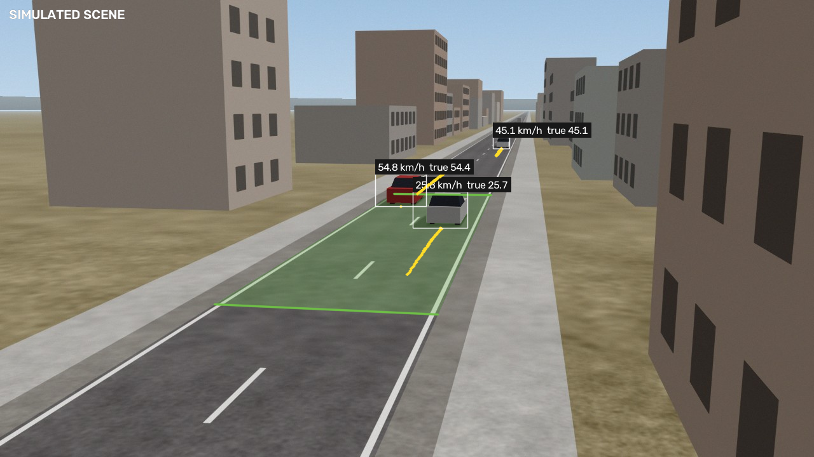
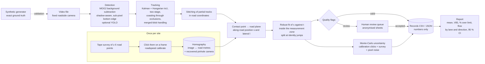
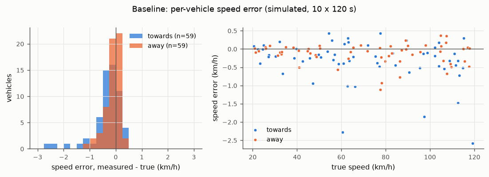
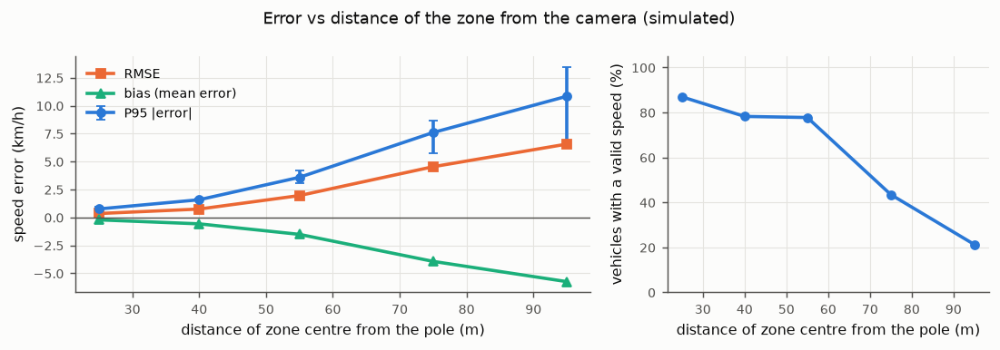
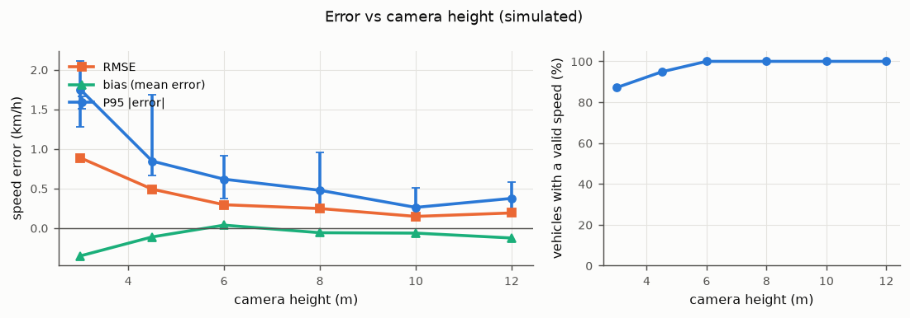
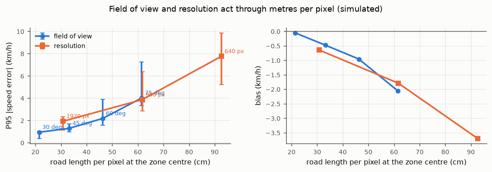
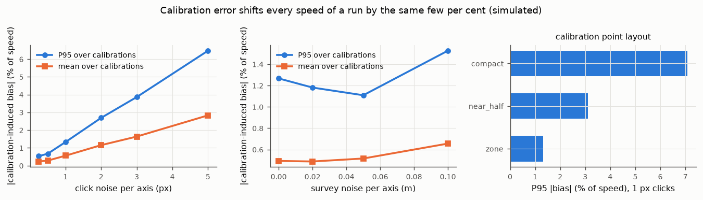
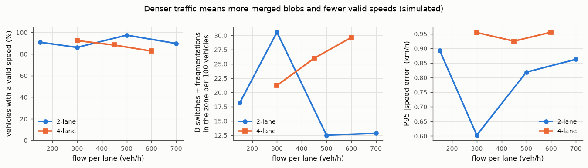
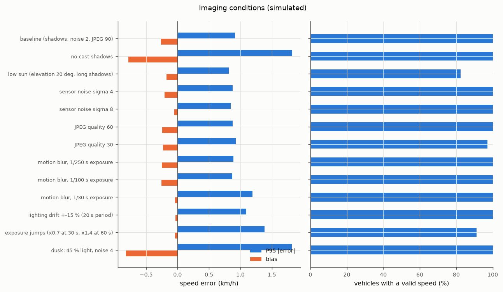
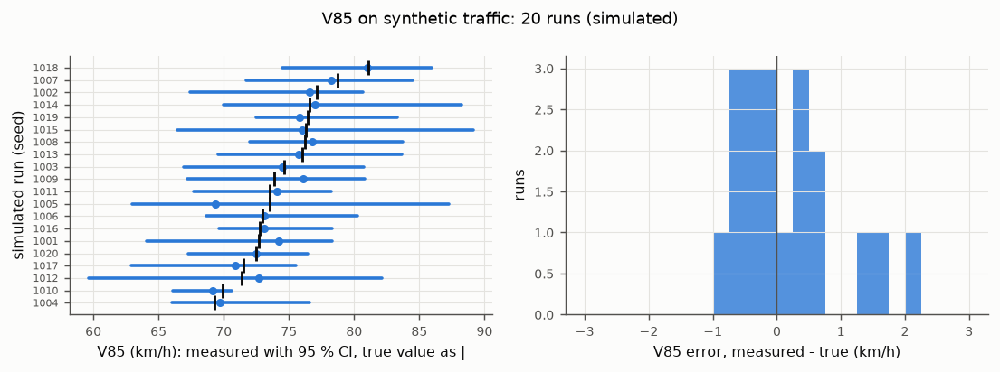

# road-speed-audit

**Measuring vehicle speeds on one road segment with one fixed camera — and showing,
on simulated video with exact ground truth, how accurate that is and what makes it
fail.**

`roadspeed` is an offline, open-source tool: a calibrated homography maps the
camera image to metres on the road, a background-subtraction detector and a
SORT/ByteTrack-style tracker follow vehicles, and a robust fit of position against
time over a defined measurement zone gives each vehicle a speed, an uncertainty and
quality flags. It writes numbers, not images, sends doubtful records to a human
review queue, and produces the statistics a municipality uses: mean speed, 85th
percentile speed (V85, the speed at or below which 85 % of vehicles travel, a
statistic widely used in speed-limit setting practice; FHWA, 2012), share over the
limit and flow, by lane and direction, with confidence intervals.

It is step one of a road-safety pilot by Space², an emerging Lebanese innovation
space that turns local needs into public-interest products: *a camera, a
homography and a tracker that measure vehicle speed on one road segment, verified
against ground truth. No faces, offline first, human review. One municipality, one
road.*

> **Status.** All accuracy figures below come from **simulated** video produced by
> the generator in this repository. The tool has **not** been validated against a
> radar or GPS reference on a real road yet; [docs/field-protocol.md](docs/field-protocol.md)
> describes how that will be done. It is an audit tool for planning, **not** a
> certified enforcement device ([docs/ethics.md](docs/ethics.md)).



*Simulated scene from experiment E01 (not a real road). White boxes: tracked
vehicles with the measured speed and the simulated vehicle's true speed; green:
the 30 m measurement zone; yellow: the contact-point trail used for the fit.*

**Headline results (simulated video, baseline set-up, 10 runs × 120 s, 134
vehicles crossing the zone; `results/e01_baseline.json`):**

- 118 of 134 simulated vehicles (88 %) received a valid speed; 6 went to human
  review, 10 were rejected as fragments, none was missed, and no valid record was
  false or duplicated.
- Error of the valid speeds: bias −0.23 km/h, RMSE 0.52 km/h, 95th percentile of
  |error| 1.01 km/h (95 % CI 0.67–1.85), maximum 2.58 km/h.
- On 20 simulated traffic runs, V85 was within an RMSE of 1.22 km/h of the truth
  and mean speed within an RMSE of 0.60 km/h (`results/e10_v85.json`).
- The error grows quickly with distance from the camera: the 95th percentile of
  |error| is 0.76 km/h with the zone centred 25 m from the pole and 3.59 km/h at
  55 m (`results/e02_distance.json`).
- Calibration layout matters more than tape precision: four points bunched at one
  end of the zone gave a 95th-percentile calibration-induced bias of 7.1 % of
  speed, nine points spread over the zone 1.3 % (`results/e09_calibration.json`).

---

## 1. Why speed

- Road traffic crashes kill approximately 1.16 million people a year and are the
  leading cause of death for children and young adults aged 5–29 (WHO, 2026).
- Speed is a central risk factor: "Every 1% increase in mean speed produces a 4%
  increase in the fatal crash risk and a 3% increase in the serious crash risk",
  and the risk of death for pedestrians hit by car fronts rises 4.5 times from
  50 km/h to 65 km/h (WHO, 2026).
- In Lebanon, WHO's 2023 country profile lists 378 reported road deaths for 2021
  against a WHO estimate of 544 (95 % CI 471–617), i.e. 9.7 per 100 000
  population; 39 % of reported fatalities were pedestrians. The national maximum
  urban speed limit is 50 km/h, and local authorities can modify limits
  (WHO, 2023).

A municipality that wants to calm a street, argue for a crossing or check whether
a measure worked needs speed data for *that* street. Radar surveys and permanent
detectors cost money and staff time; a camera on a lamp post is cheap, but only
useful if its numbers can be trusted and if it does not become a surveillance
device. This project tries to make the measurement auditable: every number comes
with an uncertainty, every doubtful case is flagged for a person, and the method's
accuracy is characterised before anyone relies on it.

## 2. How it works



**Calibration.** At least four (in practice 8–10) surveyed road points clicked in
an OpenCV picker with a magnifier, or loaded from JSON, give an image→ground
homography (normalised DLT, refined on image-space residuals). The tool reports
reprojection residuals, checks that the zone is inside the image, and recovers a
pinhole camera (focal length, height, tilt) from the homography as a plausibility
check. A helper builds points from dashed lane markings of measured geometry (it
documents a shear ambiguity that leaves along-lane speeds unaffected). See
[docs/calibration.md](docs/calibration.md).

**Detection.** OpenCV MOG2 background subtraction, initialised from the median of
frames spread over the clip, restricted to a region of interest derived from the
calibration. Grey vehicles on grey asphalt are often labelled "shadow" by MOG2, so
shadow pixels connected to real foreground are kept. The foreground threshold sits
in the tail of a blurred edge, which places the blob's bottom a few pixels below
the vehicle; the bottom edge is therefore re-located at sub-pixel precision at the
50 % level of the difference to the background model (experiment E12 measures what
this buys). An optional YOLO backend (`pip install roadspeed[yolo]`, local weights
only) is included but not exercised by the experiments.

**Tracking.** A constant-velocity Kalman filter on boxes, Hungarian assignment on
1 − IoU in ByteTrack's two stages, a centre-distance fallback for small fast boxes,
coasting for up to 1 s through occlusions, and merged-blob handling: when one blob
covers two predicted vehicles (typical when opposite-direction traffic crosses far
from a roadside camera) only the vehicle whose bottom edge the blob matches is
updated, the other coasts (for up to 3 s). After tracking, partial tracks of one
vehicle (typically restarted after such a merge) are stitched in road coordinates
when lane, direction, speed and the predicted position at the junction agree.

**Speed.** The bottom-centre of each box is mapped to the road plane and expressed
as along-road position *s*. A Huber-robust straight line *s(t)* over the
observations inside the measurement zone gives the speed. Tracks are split where
*s* jumps or reverses (an identity carried from one vehicle to another). Hard flags
(too few points, partial zone, implausible speed) reject a record; soft flags (large
residuals, gaps, merged or wide blobs, ambiguous lane, direction mismatch, high
uncertainty) send it to review.

**Uncertainty.** Monte Carlo over the calibration (click noise and tape noise on
every control point, re-fit, re-project, re-fit the speed) and over the contact
point (pixel noise estimated per track from the fit residuals). Calibration error
is shared by all vehicles of a run, so the report carries its draws into the
confidence intervals of mean speed and V85 instead of letting it average away.

**Outputs.** `records.csv` / `records.json` (time, lane, direction, speed,
uncertainty, interval, quality flags; no images), `summary.json`,
`review_queue.json`, optional anonymised review sheets (pixelated, blurred crops
plus the position-time fit), and `report.html` with figures.

## 3. Validation on simulated video

### The generator

`roadspeed synth` renders road scenes with a calibrated pinhole camera in
numpy/OpenCV: a procedurally textured road plane with analytically anti-aliased
lane markings, pavements and roadside buildings, vehicles as shaded multi-part
3-D boxes with realistic sizes, ground clearance and wheels (cars, SUVs, vans,
trucks, buses, motorcycles), two or four lanes in both directions, speeds drawn
from 20–120 km/h, Poisson arrivals with no in-lane overtaking, cast and contact
shadows, optional motion blur, lighting drift and exposure jumps, sensor noise
and JPEG compression, static occluders, and any frame rate or resolution. Every
vehicle's true speed and every frame's true visible box (from an ID buffer) are
known exactly. Frames are deterministic per seed.

The experiments run the *full* pipeline on the rendered frames, exactly as on a
video file, and match records to simulated vehicles frame by frame. The
calibration is simulated too: nine lane-marking points at the start, middle and
end of the zone, clicked with 0.7 px Gaussian error and rounded to whole pixels,
"surveyed" with 2 cm error.

**Baseline set-up:** two-lane two-way road (3.5 m lanes), camera on a 6 m pole
1.5 m outside the shoulder, 60° horizontal field of view, 1280×720, 30 frames/s,
aimed at the centre of a 30 m measurement zone 20–50 m from the pole,
300 vehicles/h per lane.

All numbers in this section are copied from `results/tables.md`, which
`experiments/tables.py` generates from the JSON files in `results/`; all figures
are generated by the experiment scripts. Everything is **simulated**. 95 % CIs on
error statistics are bootstrap intervals over vehicles. "Valid %" is the share of
simulated vehicles crossing the zone that received a valid (unflagged) speed;
"95 % CI coverage" is the share of valid records whose stated 95 % interval
contains the true speed.

### 3.1 Baseline accuracy (E01)

| metric | value |
|---|---:|
| simulated runs x duration | 10 x 120 s |
| vehicles crossing the zone | 134 |
| valid speed / review only / rejected only / missed | 118 / 6 / 10 / 0 |
| bias (km/h) [95% CI] | -0.23 [-0.33, -0.15] |
| RMSE (km/h) [95% CI] | 0.52 [0.36, 0.67] |
| P95 abs error (km/h) [95% CI] | 1.01 [0.67, 1.85] |
| max abs error (km/h) | 2.58 |
| relative error: bias / P95 abs (%) | -0.33 / 1.63 |
| per-vehicle 95% interval covers the truth | 92 % |
| median stated uncertainty u (km/h) | 0.41 |
| false valid records / duplicate valid records | 0 / 0 |
| ID switches / fragmentations inside the zone | 11 / 31 |



Approaching vehicles were measured less accurately than receding ones (95th
percentile of |error| 1.51 vs 0.68 km/h, 59 vehicles each), and the seven
motorcycles had the largest errors (bias −1.01 km/h, 95th percentile 2.03 km/h)
(`results/e01_baseline.json`). By speed band the 95th percentile of |error| is
0.37 km/h at 20–40 km/h and 1.21 km/h at 100–120 km/h; relative to speed it stays
between 0.9 and 1.6 % in every band (`results/e07_speed.json`, `figures/e07_speed.png`). The stated per-vehicle
95 % intervals covered the truth for 92 % of valid records: slightly too narrow.

### 3.2 Where to put the camera: distance, height, tilt, frame rate (E02–E04, E06)

Each experiment varies one parameter from the baseline (4 runs × 90 s per level;
3 runs for tilt).

**Distance of the zone from the pole** (30 m zone, camera re-aimed at its centre):

| zone centre (m) | runs | vehicles | valid % | bias km/h | RMSE km/h | P95 abs km/h [95% CI] | 95% CI coverage |
|---:|---:|---:|---:|---:|---:|---:|---:|
| 25 | 4 | 46 | 87 | -0.21 | 0.35 | 0.76 [0.52, 0.92] | 90 |
| 40 | 4 | 46 | 78 | -0.57 | 0.75 | 1.58 [1.03, 1.72] | 86 |
| 55 | 4 | 45 | 78 | -1.51 | 1.96 | 3.59 [3.05, 4.19] | 54 |
| 75 | 4 | 46 | 43 | -3.93 | 4.54 | 7.60 [5.78, 8.69] | 15 |
| 95 | 4 | 47 | 21 | -5.74 | 6.56 | 10.84 [6.47, 13.46] | 20 |
| 115 | 4 | 45 | 0 | – | – | – | – |



The bias turns increasingly negative with distance: a pixel covers more road far
away (from 10 cm to 2 m along the road at the zone centre over this range), so any
residual offset of the detected bottom edge, which is a matter of pixels, becomes a
larger distance on the road, and more blobs merge. At 115 m no vehicle was measured.

**Camera height:**

| height (m) | runs | vehicles | valid % | bias km/h | RMSE km/h | P95 abs km/h [95% CI] | 95% CI coverage |
|---:|---:|---:|---:|---:|---:|---:|---:|
| 3.0 | 4 | 39 | 87 | -0.35 | 0.89 | 1.75 [1.28, 2.11] | 82 |
| 4.5 | 4 | 39 | 95 | -0.11 | 0.49 | 0.85 [0.66, 1.68] | 86 |
| 6.0 | 4 | 39 | 100 | 0.04 | 0.29 | 0.62 [0.37, 0.91] | 97 |
| 8.0 | 4 | 39 | 100 | -0.06 | 0.25 | 0.48 [0.29, 0.95] | 97 |
| 10.0 | 4 | 39 | 100 | -0.06 | 0.15 | 0.26 [0.17, 0.51] | 100 |
| 12.0 | 4 | 39 | 100 | -0.13 | 0.19 | 0.37 [0.21, 0.58] | 100 |



**Tilt** (offset from aiming at the zone centre, ±6°) changed little: 95th
percentile of |error| 1.03–1.38 km/h at 91 % valid for every level
(`results/e04_tilt.json`, `figures/e04_tilt.png`). **Frame rate** between 10 and
50 frames/s made no measurable difference for a 30 m zone: 95th percentile
of |error| 0.93–0.98 km/h at 92–95 % valid (`results/e06_fps.json`,
`figures/e06_fps.png`), which suggests that the line fit has enough points at
10 frames/s and the error is dominated by where the bottom edge is found, not by
how often.

### 3.3 Field of view and resolution act through metres per pixel (E05)

Zone 40–70 m, 3 runs × 90 s per condition.

| condition | cm of road per px | valid % | bias km/h | RMSE km/h | P95 abs km/h [95% CI] |
|---|---:|---:|---:|---:|---:|
| HFOV 30 deg, 1280 px | 21.5 | 97 | -0.05 | 0.39 | 0.95 [0.39, 1.00] |
| HFOV 45 deg, 1280 px | 33.2 | 97 | -0.48 | 0.69 | 1.30 [0.97, 1.70] |
| HFOV 60 deg, 1280 px | 46.3 | 87 | -0.96 | 1.34 | 2.18 [1.58, 3.90] |
| HFOV 75 deg, 1280 px | 61.5 | 65 | -2.05 | 2.68 | 4.02 [3.34, 7.26] |
| HFOV 60 deg, 640 px | 92.6 | 55 | -3.70 | 4.48 | 7.76 [5.20, 9.86] |
| HFOV 60 deg, 960 px | 61.7 | 84 | -1.79 | 2.37 | 3.87 [2.85, 6.39] |
| HFOV 60 deg, 1920 px | 30.9 | 87 | -0.65 | 0.91 | 1.94 [1.13, 2.33] |



Narrowing the field of view and raising the resolution both shrink the road length
covered by one pixel, and the error follows that quantity. The relation is
approximate: the 1280 px / 60° condition here and the 40 m zone of E02 both have
about 46 cm per pixel and gave 95th percentiles of 2.18 and 1.58 km/h.

### 3.4 Calibration error (E09)

Detection and tracking were run once per seed (6 runs × 90 s); speed estimation was
then repeated with 8 independently simulated field calibrations per setting (48 per
row). Calibration error is shared by all vehicles of a run, so it appears as a
per-run bias.

| varied | value | simulated calibrations | mean abs run bias % | P95 abs run bias % | per-vehicle CI coverage |
|---|---|---:|---:|---:|---:|
| click | 0.25 | 48 | 0.23 | 0.54 | 80 % |
| click | 0.5 | 48 | 0.28 | 0.67 | 88 % |
| click | 1.0 | 48 | 0.56 | 1.33 | 92 % |
| click | 2.0 | 48 | 1.15 | 2.69 | 92 % |
| click | 3.0 | 48 | 1.64 | 3.86 | 95 % |
| click | 5.0 | 48 | 2.83 | 6.47 | 96 % |
| survey | 0.0 | 48 | 0.49 | 1.27 | 92 % |
| survey | 0.02 | 48 | 0.49 | 1.18 | 97 % |
| survey | 0.05 | 48 | 0.52 | 1.11 | 100 % |
| survey | 0.1 | 48 | 0.66 | 1.53 | 100 % |
| layout | compact | 48 | 3.32 | 7.08 | 97 % |
| layout | near_half | 48 | 1.30 | 3.10 | 98 % |
| layout | zone | 48 | 0.50 | 1.32 | 94 % |



Click precision matters roughly linearly (1 px per axis → 1.3 % at the 95th
percentile); tape errors up to 10 cm per axis matter little with nine points; the
layout matters most: four points bunched within 6 m at one end of the zone gave
about five times the bias of nine points spread over it. The Monte-Carlo
uncertainty, told the true noise levels, covered the truth for 88–100 % of valid
records, except at the smallest click noise (80 %) where other errors dominate.

### 3.5 Traffic density, occlusion and the tracker (E08)

3 runs × 90 s per condition.

| road | flow /lane/h | variant | vehicles | valid % | zone ID sw. + frag. /100 veh | P95 abs km/h | MOTA |
|---|---:|---|---:|---:|---:|---:|---:|
| 2-lane | 150 | default | 22 | 91 | 18.2 | 0.89 | 0.89 |
| 2-lane | 300 | default | 36 | 86 | 30.6 | 0.60 | 0.84 |
| 2-lane | 500 | default | 40 | 98 | 12.5 | 0.82 | 0.79 |
| 2-lane | 700 | default | 39 | 90 | 12.8 | 0.86 | 0.83 |
| 4-lane | 300 | default | 66 | 92 | 21.2 | 0.95 | 0.81 |
| 4-lane | 450 | default | 77 | 88 | 26.0 | 0.92 | 0.79 |
| 4-lane | 600 | default | 81 | 83 | 29.6 | 0.96 | 0.74 |
| 2-lane | 300 | lamp post | 36 | 50 | 94.4 | 1.52 | 0.74 |
| 2-lane | 300 | lamp post, no occlusion handling | 36 | 53 | 105.6 | 2.00 | 0.70 |
| 4-lane | 450 | no occlusion handling | 77 | 86 | 35.1 | 0.96 | 0.74 |



Accuracy held up with traffic (95th percentile under 1 km/h up to 700 veh/h per
lane on two lanes and 600 on four), and the valid share stayed between 83 % and
98 %. A single lamp post near the camera, crossing the line of sight to the zone,
was far more damaging: only 50 % of vehicles got a valid speed (86 % without the
post); 15 of the 36 vehicles ended with only rejected fragments, i.e. the post cut
their tracks into pieces that the stitching did not rejoin. Turning off the
tracker's occlusion handling (coasting and merged-blob logic) raised zone identity
switches plus fragmentations on the four-lane road from 26.0 to 35.1 per 100
vehicles and lowered the valid share from 88 % to 86 %; with the lamp post it
raised the 95th percentile of |error| from 1.52 to 2.00 km/h, while the valid
share was 53 % instead of 50 %. The benefit of the occlusion handling is modest in
these runs, and it does not solve the static-occluder case.

### 3.6 Imaging conditions (E11)

3 runs × 90 s per condition (34 vehicles each).

| condition | vehicles | valid % | bias km/h | P95 abs km/h | 95% CI coverage |
|---|---:|---:|---:|---:|---:|
| baseline (shadows, noise 2, JPEG 90) | 34 | 100 | -0.26 | 0.91 | 97 % |
| no cast shadows | 34 | 100 | -0.78 | 1.82 | 59 % |
| low sun (elevation 20 deg, long shadows) | 34 | 82 | -0.18 | 0.82 | 100 % |
| sensor noise sigma 4 | 34 | 100 | -0.20 | 0.88 | 100 % |
| sensor noise sigma 8 | 34 | 100 | -0.05 | 0.84 | 100 % |
| JPEG quality 60 | 34 | 100 | -0.24 | 0.87 | 97 % |
| JPEG quality 30 | 34 | 97 | -0.23 | 0.93 | 100 % |
| motion blur, 1/250 s exposure | 34 | 100 | -0.25 | 0.89 | 97 % |
| motion blur, 1/100 s exposure | 34 | 100 | -0.25 | 0.87 | 97 % |
| motion blur, 1/30 s exposure | 34 | 100 | -0.04 | 1.19 | 100 % |
| lighting drift +-15 % (20 s period) | 34 | 100 | -0.03 | 1.09 | 97 % |
| exposure jumps (x0.7 at 30 s, x1.4 at 60 s) | 34 | 91 | -0.04 | 1.38 | 90 % |
| dusk: 45 % light, noise 4 | 34 | 100 | -0.82 | 1.82 | 59 % |



Sensor noise, JPEG compression, motion blur and slow lighting drift changed the
95th percentile of |error| by at most 0.3 km/h. The two conditions without cast
shadows (no shadows; dusk) doubled it and left the stated intervals covering only
59 % of vehicles — presumably because in this simulator the sharp ground-level edge
of a cast shadow in front of the vehicle is what the bottom-edge refinement locks
onto best, and without it the edge is found slightly off. Low sun and exposure jumps cost valid records (82 % and
91 % valid) rather than accuracy.

### 3.7 Which point stands for the vehicle (E12), and correcting with reference passes (E13)

| model | vehicles | valid % | bias km/h | RMSE km/h | P95 abs km/h |
|---|---:|---:|---:|---:|---:|
| bottom edge, sub-pixel refined (default) | 34 | 100 | -0.10 | 0.50 | 1.07 |
| bottom edge, raw blob boundary | 34 | 100 | -1.30 | 1.46 | 2.60 |
| box centre, ground homography | 34 | 79 | 11.00 | 11.78 | 17.42 |
| box centre, height-corrected (0.75 m) | 34 | 88 | 0.59 | 1.50 | 3.36 |

The sub-pixel bottom edge is the best of the four models. Without the refinement
the raw blob boundary biases speeds by −1.30 km/h, and the stated intervals cover
the truth for only 6 % of vehicles (a systematic error the uncertainty model does
not know about). The box centre pushed through the ground homography overestimates
speed by 11 km/h because the point is above the road; correcting it with an assumed
0.75 m height recovers most of that but stays worse than the bottom edge
(`results/e12_contact.json`, `figures/e12_contact.png`).

Mean absolute run bias in % of speed.

| case | runs | none | k=1 | k=3 | k=5 | k=10 | k=20 |
|---|---:|---:|---:|---:|---:|---:|---:|
| 360p_zone40-70 | 1 | 6.10 | 2.50 | 1.87 | 1.71 | – | – |
| 720p_baseline | 10 | 0.39 | 0.31 | 0.22 | 0.20 | 0.24 | – |

E13 asks whether a few passes of a vehicle with independently known speed (the
field protocol's GNSS probe) can remove a site's residual bias, by estimating a
scale factor from k vehicles and applying it to the rest of the run. In the 720p
baseline the residual bias is already small (0.39 % of speed) and 5 passes halve it
(0.20 %). Only one 640×360 run had enough valid vehicles for this analysis; there,
5 passes reduced a 6.10 % bias to 1.71 % — an illustration, not a measurement.

### 3.8 Municipal statistics on simulated traffic (E10)

20 runs × 180 s, speeds drawn from Normal(62, 12) km/h (an assumed distribution),
limit 50 km/h. Each run's report is compared with the truth of the 19–29 simulated
vehicles that crossed the zone in that run (`results/e10_v85.json`).

| statistic | runs | mean error | RMSE | max abs error | 95% CI covers truth | mean CI width |
|---|---:|---:|---:|---:|---:|---:|
| mean speed (km/h) | 20 | -0.07 | 0.60 | 1.26 | 100 % | 9.35 |
| V85 (km/h) | 20 | -0.03 | 1.22 | 4.22 | 100 % | 13.55 |
| share over 50 km/h | 20 | -0.65 | 1.59 | 3.85 | 100 % | 24.83 |

Share over the limit in percentage points.

Flow: mean count error -0.85 vehicles per run (max abs 3), mean relative flow error -3.5 %.



All 20 intervals contained the true value, but they are wide (13.6 km/h on average
for V85) because they include the sampling uncertainty of 19–29 vehicles; a real
survey over days would have far more vehicles. Counts were slightly low
(−0.85 vehicles per run on average, at most 3), as rejected fragments are not
counted.

### 3.9 Is the stated uncertainty honest?

Where random error dominates — the baseline and most near-zone conditions — the
per-vehicle 95 % intervals covered the truth for 82–100 % of valid records. Where
a systematic error dominates, they are too narrow: 54 % coverage with the zone
centred 55 m away, 15–20 % beyond, 59 % without cast shadows, 6 % with the raw blob
boundary. The uncertainty model propagates calibration and pixel noise only; the
field validation must measure the systematic part.

## 4. Placement guidance (from simulation only)

`experiments/guidance.py` turns the sweeps into statements, written to
`results/guidance.json`. A level "meets the target" when, pooled over its runs, the
95th percentile of |error| of valid speeds is at most the target **and** at least
80 % of the simulated vehicles got a valid speed. One parameter is varied at a time
around the baseline (6 m pole, 60° field of view, 1280×720, 30 frames/s, zone
20–50 m, two-lane road).

| parameter | target: 95 % of valid speeds within ±2 km/h | target: within ±1 km/h | source |
|---|---|---|---|
| camera height | all tested heights (3–12 m) met it | 4.5 m or higher | `e03_height.json` |
| distance of zone centre from the pole | 25 m met it; at 40 m the error met it but only 78 % of vehicles were measured | 25 m | `e02_distance.json` |
| road length per pixel along the road, at the zone centre | at most 33 cm | at most 21 cm (one tested condition) | `e05_resolution.json` |
| frame rate | 10 frames/s and above (all tested, 10–50) | 10 frames/s and above | `e06_fps.json` |
| tilt (±6° around aiming at the zone centre) | every level met it | no level met it (1.03–1.38 km/h) | `e04_tilt.json` |
| traffic flow per lane | up to 700 veh/h (2-lane) and 600 veh/h (4-lane), the highest tested | same | `e08_density.json` |

In words, for a two-lane road in this simulator: **mount the camera at least
4.5 m high, keep the measurement zone close (centre within about 25–40 m of the
pole) so that one pixel covers no more than about a third of a metre of road, and
aim at the zone centre; 10 frames/s was already enough.** (3 m of height met the
±2 km/h target too.)

Read the ±1 km/h column with care: the baseline set-up appears with different seeds
in E01, E03 (6 m), E04 (0°) and E06 (30 frames/s), and its 95th percentile
of |error| ranged from 0.62 to 1.06 km/h across those experiments, so differences of a
few tenths of a km/h between levels are within run-to-run spread at these sample
sizes. Two further lessons are not captured by the table: keep poles and trees out of the line of sight to the zone
(E08: one lamp post cut the measured share from 86 % to 50 %), and survey calibration points over
the whole zone rather than at one end (E09). The guidance inherits every limitation
below; the field pilot has to confirm it.

## 5. Run it on your own video

```bash
make setup                                   # .venv with the package and dev tools
source .venv/bin/activate

# 1. calibrate once per site (see docs/calibration.md)
roadspeed calibrate --video my_road.mp4 --frame 200 --survey survey.json \
  --out site.json --zone 20 50 \
  --lane towards-1:-1.75:3.5:towards --lane away-1:1.75:3.5:away \
  --speed-limit 50 --check-image check.png

# 2. measure
roadspeed run my_road.mp4 --config site.json --out run/ --review-sheets

# 3. review flagged records (a = accept, r = reject), then report
roadspeed review run/
roadspeed report run/ --title "Main Street, week 1"
```

`site.json` also holds detector, tracker, speed and uncertainty options
(see `roadspeed/calibration.py`). Try the whole chain on simulated data first:
`make demo` renders a 60 s clip, measures it and writes `work/demo/run/report.html`.
An example report from a simulated clip is in [`results/demo/`](results/demo/).

Requirements: Python ≥ 3.11, numpy, scipy, opencv-python, matplotlib. No GPU, no
downloads, no network at run time.

## 6. Reproduce

```bash
make setup
make test               # unit tests + a synthetic video end-to-end test (~1 min)
make reproduce-quick    # small version of every experiment -> results/quick/ (minutes)
make reproduce          # full experiments -> results/, figures/ (roughly 1.5-2 h with 6 worker processes)
```

All seeds are fixed and outputs are rounded, so `make reproduce` rewrites
`results/` and `figures/` byte for byte on the same software stack
(`results/manifest.json` records the versions used here). `ROADSPEED_WORKERS`
sets the number of parallel processes.

## 7. Limitations

What the simulation does **not** capture, and therefore what the numbers above do
not promise:

- **The world is simplified.** A flat straight road, an ideal pinhole lens with no
  distortion or rolling shutter, vehicles as boxes with uniform paint, no
  pedestrians, cyclists, parked cars, moving trees, rain, night or headlights, and
  vehicles that keep a constant speed and never change lane. Real detection will be
  harder and real errors larger.
- **The detector's main weaknesses are real.** Background subtraction merges
  vehicles that overlap in the image, and its boundaries are biased by blur,
  shadows and the threshold. The merged-blob logic, stitching and the sub-pixel
  edge help in simulation; the remaining bias grows with distance and road length
  per pixel (E02, E05), depends on lighting (E11), and its size on real footage is
  unknown until the field validation. A static occluder in front of the zone halved
  the valid share (E08).
- **Method and simulator were developed together.** Design choices (shadow
  handling, edge refinement, stitching, thresholds such as the wide-blob limit) were
  tuned on pilot simulations with seeds other than the reported ones, but on the same
  simulator. Results on another renderer or on real video may be worse.
- **The uncertainty model is partial.** It propagates calibration and pixel noise,
  not systematic effects; where those dominate, the stated intervals are too narrow
  (section 3.9).
- **Statistics exclude flagged records** until a person accepts them. If difficult
  cases differ systematically (motorcycles, heavy vehicles, dense traffic), the
  published statistics are biased; the report shows the counts so this can be
  judged.
- **Small samples in places.** Several conditions rest on 22–47 simulated vehicles;
  the bootstrap intervals in the tables show how much the 95th percentiles could
  move.
- **Not certified, not for enforcement** ([docs/ethics.md](docs/ethics.md)). The
  optional YOLO backend is implemented and unit-tested with a stand-in model only.

## 8. Next steps: the field pilot

1. With one municipality, choose one road segment that matches the simulated
   guidance, agree purpose, retention and publication in writing, and put up a
   public notice.
2. Survey and calibrate the site with a tape ([docs/field-protocol.md](docs/field-protocol.md)).
3. Validate against a GNSS probe vehicle (at least 30 passes per direction) and, if
   available, a radar gun; analyse with Bland–Altman limits of agreement; decide
   against acceptance criteria fixed in advance.
4. Only if the site passes: run a measurement week, review flagged records, and
   publish the aggregated statistics with their intervals and the validation
   report.
5. Feed what the field shows back into the simulator (lens distortion, real vehicle
   appearance, rolling shutter, static occluders) and into the method (for example
   masking known occluders and stitching across them).

## 9. Repository layout

```
src/roadspeed/      geometry, calibration, detect/, tracking, stitch, speed, uncertainty,
                    pipeline, records, review, privacy, report, evaluate, cli
src/roadspeed/synth scene description, vehicle models, renderer, presets, export
experiments/        e01-e13 experiment definitions, run_all.py, guidance, tables
results/            experiment outputs (JSON / CSV) and tables.md, guidance.json
figures/            experiment figures
docs/               field protocol, ethics, calibration guide, portfolio summary
tests/              pytest suite
```

## References

- World Health Organization (2026). *Road traffic injuries* (fact sheet, updated
  20 July 2026). https://www.who.int/news-room/fact-sheets/detail/road-traffic-injuries
- World Health Organization (2023). *Global status report on road safety 2023.*
  Geneva: WHO. https://www.who.int/publications/i/item/9789240086517
- World Health Organization (2023). *Global status report on road safety 2023:
  country profile, Lebanon.* https://www.who.int/publications/m/item/road-safety-lbn-2023-country-profile
- Federal Highway Administration (2012). *Methods and Practices for Setting Speed
  Limits: An Informational Report.* FHWA-SA-12-004.
- Bland, J. M., & Altman, D. G. (1986). Statistical methods for assessing agreement
  between two methods of clinical measurement. *The Lancet*, 327(8476), 307–310.
- Hartley, R., & Zisserman, A. (2004). *Multiple View Geometry in Computer Vision*
  (2nd ed.). Cambridge University Press.
- Zivkovic, Z. (2004). Improved adaptive Gaussian mixture model for background
  subtraction. *Proc. ICPR 2004*, 28–31.
- Bewley, A., Ge, Z., Ott, L., Ramos, F., & Upcroft, B. (2016). Simple online and
  realtime tracking. *Proc. ICIP 2016*, 3464–3468.
- Zhang, Y., Sun, P., Jiang, Y., Yu, D., Weng, F., Yuan, Z., Luo, P., Liu, W., &
  Wang, X. (2022). ByteTrack: Multi-object tracking by associating every detection
  box. *Proc. ECCV 2022*.
- Lebanon, Law No. 81 of 10 October 2018 on Electronic Transactions and Personal
  Data. UN ESCWA legislation database:
  https://alp.unescwa.org/legislations/law-81-2018-electronic-transactions-and-personal-data

## Licence and citation

MIT licence (see `LICENSE`). If you use this work, please cite it using
`CITATION.cff` (Rami Kronbi, independent researcher).
